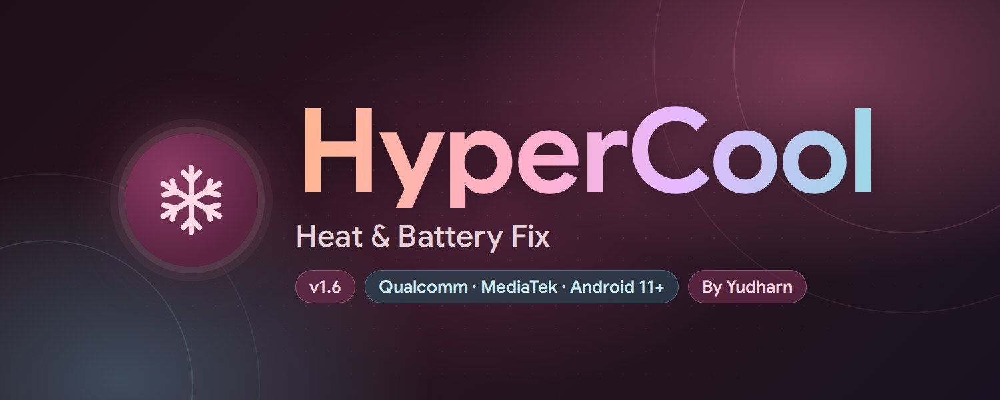

# HyperCool - Heat & Battery Fix

By Yudharn

KernelSU / Magisk module with a WebUI for Android phones with a Qualcomm or MediaTek SoC.
Every feature has its own switch. Tuned and tested on POCO F5 (marble, HyperOS 3).
The module does **not** run in the background: `service.sh` waits for boot,
applies each enabled feature **once**, writes a report and exits. Only exceptions, and only
while its switch is ON: the small charge-limit keeper (see `charge_limit`) and the daily
app-cache keeper (see `x_cache_auto`, ON by default; both only sleep and check a timestamp).
Changes made in the WebUI take effect after the next reboot.

## How it works
| Stage | What happens |
|---|---|
| post-fs-data | Builds the GMS Doze sysconfig overlay (before mounting), sets `log.tag` if enabled |
| service (once) | Waits for `sys.boot_completed`, sleeps `apply_delay`, applies all features, exits |
| WebUI | Edits `/data/adb/hypercool/config.conf`, shows last-boot status per feature |
| Turning a system option OFF | Original value (backed up on first apply) is restored on next boot |
| Uninstall | All ROM changes restored after boot, data folder removed |

Kernel values are never persisted - they reset on every reboot by themselves.

## Features
### Heat control (kernel)
- `cpu_cap` Big/prime cluster max-frequency cap (95 / 88 / 80 %), little cluster untouched;
  `cpu_cap_lock` (default on) makes scaling_max_freq read-only after the cap so ROM boosters cannot raise it
- `gpu_cap` Remove top 1-4 Adreno power levels (max_pwrlevel / devfreq max_freq / max_gpuclk, at most half)
- `gpu_idle` GPU power collapse: force_*_on=0, bus_split=1, idle_timer<=64, throttling=1
- `walt_tune` WALT/schedutil: pl=0, rtg_boost_freq=0, hispeed_load 95, up_rate_limit >= 1 ms, sched_boost 0
- `input_boost_off` Kernel touch boost off (WALT input_boost / cpu_boost)
- `bg_cpuset` background / system-background / restricted -> little cores, uclamp.max 50 %
- `prime_park` (experimental) park the prime cluster via core_ctl
- `blur_off` Android window blur off; HyperOS/MIUI blur props on Xiaomi ROMs (GPU heat)
- `charge_cool` Charge current limit via battery/charge_control_limit: pick a calibrated level directly or map an mA value
- `charge_limit` Xiaomi night_charging flag, charging stops near 80% (Xiaomi only). The charger
  driver clears the flag on every unplug (measured on marble), so `common/chg_watch.sh` sets it
  again while a charger is connected: checks every 15 s, no wakelock, frozen in deep sleep,
  exits when the module is disabled/removed; not started when the switch is off

Every numeric option has presets plus a Custom value field in the WebUI.

### Battery drain (kernel)
- `cpu_idle` LPM sleep allowed, disabled cpuidle states re-enabled
- `ufs_pm` UFS clkgate / clkscale / hibern8_on_idle
- `vm_tune` writeback 30 s, dirty ratios 10/30, stat_interval 10
- `io_tune` iostats=0, add_random=0
- `debug_off` printk quiet, ftrace off, schedstats off, driver debug_mask=0
- `wakelock_block` (experimental) Boeffla wakelock blocker, scan-only default; notification wakelocks are never blocked

### Protected apps (WhatsApp etc.)
- `protect_apps` + `protect_pkgs` (app picker in WebUI): each app is added to the Doze
  battery-optimization whitelist, gets RUN_ANY_IN_BACKGROUND / RUN_IN_BACKGROUND / WAKE_LOCK
  = allow, Xiaomi autostart (MIUI app-op 10008, Xiaomi ROMs) and the ACTIVE standby bucket. Protected apps,
  default dialer / SMS / keyboard / launcher are excluded from every restriction.
- `app_bucket` puts other unused user apps into the rare / restricted standby bucket at boot.
- `bg_block` + `bg_block_pkgs` (app picker): the opposite of protected apps. Picked apps get
  RUN_ANY_IN_BACKGROUND / RUN_IN_BACKGROUND / WAKE_LOCK = ignore, Xiaomi autostart off, removed from the
  user Doze whitelist, Restricted bucket and a force-stop at boot. Protected apps and system defaults are
  skipped; every change is reverted to the previous mode/bucket when an app is removed or the switch is off.

### Battery drain (system)
- `app_freezer` cached apps freezer
- `doze_aggr` levels moderate / aggressive / maximum / custom (`doze_custom` string),
  written to device_config `device_idle` and `global device_idle_constants`
- `devcfg_lock` pause device_config server sync so the values above are not overwritten
- `gms_doze` remove Google Play services from the Doze whitelist (runtime sys-whitelist removal + optional sysconfig overlay)
- `scan_off` Wi-Fi / BLE always-scanning off
- `net_save` mobile data always-on off, network recommendations off, Wi-Fi wakeup off
- `standby` App Standby / adaptive battery / forced standby / auto restriction on
- `debloat` disable-user on a user-editable package list (only re-enables what it disabled)
- `joyose_off` disable com.xiaomi.joyose (Xiaomi only)
- `stats_reduce` battery_stats_constants, binder/looper stats off, jank monitor & PSS profiling off
- `tracking_off` clearcut / analytics / network watchlist / tron switches off
- `debug_props` runtime-only debug, ramdump, offline-log and trace props
- `log_reduce` log.tag=W (non-persistent)

### Long battery
- `saver_policy` balanced / extreme / custom `battery_saver_constants` (Android 12+ and legacy keys)
- `saver_trigger` AOSP auto Battery Saver percentage
- `refresh_rate` peak refresh rate cap (60/90/120)
- `anim_scale` animation scale 0.75x / 0.5x

### More (new in v1.1, WebUI tab "More")
Safe ones (kernel log silence, network tuning, Xiaomi boost frameworks, telemetry, diagnostics, log props, daily cache clean) are ON by default; the rest are OFF until you switch them on.

- `x_sched` Extra kernel tuning: scheduler latency/granularity, autogroup,
  panic handlers off, plus quiet-kernel extras (EDAC logging off, printk ratelimit,
  ftrace dump on oops off, ramdump collection off)
- `x_kquiet` Quiet kernel: suppress non-critical kernel logging paths (EDAC, BPF trace,
  block dump, resume-IRQ debug)
- `x_net` Network tuning: TCP fastopen, no slow-start after idle, no metrics save, inotify limits
  (syncookies untouched)
- `x_io` Extra I/O tuning: VM dirty ratios, writeback, cache pressure, overcommit, swappiness
- `x_xiaomi_fw` Xiaomi framework tuner (XIAOMI ONLY): migt/metis framework settings
- `x_ram_opt` RAM optimizer: VM reclaim, extra_free_kbytes, zram retune, LMK minfree or
  lmkd props (persisted `ro.lmk.*` props are tracked and deleted again when turned off)
- `x_multitask` Multitasking boost: cached-process limits (moderate / high / maximum)
- `x_gms_freeze` GMS safe freeze: disables telemetry/analytics components of Google Play
  services only (safe list - connectivity, payments and sync are never touched)
- `x_track` Tracking off: extra analytics / telemetry settings
- `x_log_nuke` Log cleaner: stops log daemons, shrinks logcat buffers, dropbox tags off
- `x_diag` Diagnostics off: statsd / incident / anr traces off
- `x_props` Extra safe props: runtime-only (`resetprop -n`) debug/profiler/logging props,
  nothing persisted
- One-shot actions in the More tab: **Clean RAM now** (safe / aggressive / extreme, always
  respects your protected apps, default dialer/SMS/keyboard/launcher and the foreground app)
  and **Clean junk files now** (ANR traces, tombstones, dropbox, package cache,
  logcat/dmesg buffers, fstrim)

## Nothing is applied without a switch
Every write, setting, prop and package change belongs to one feature switch, and
each feature shows the exact list in the WebUI ("What it changes"). With every
switch OFF the module writes nothing at all (verified by tracing every command).
Sub-values accept 0 = keep the stock value.

Housekeeping that is NOT a tweak: the module description in the manager is updated
with the last-boot summary, and status/log/backup files are kept in /data/adb/hypercool.

## Deliberately NOT included
- **Thermal sconfig / thermal profile switching**: HyperOS rewrites `sconfig` per foreground app,
  so a one-shot write is lost within seconds; it only works with a background daemon.
- **Disabling thermal throttling**: opposite of the goal, and linked to screen freezes on marble.
- **Screen-off CPU profiles, per-app profiles**: need a background service.
- **Classic "battery build.prop" lines** (pm.sleep_mode, ro.ril.disable.power.collapse,
  wifi.supplicant_scan_interval ...): no effect on modern Android.
- **Screen-off connectivity killers**: any script that turns Wi-Fi / mobile data / Bluetooth
  off during sleep or screen-off and back on at wake is intentionally excluded - it breaks notifications and background sync.
- **Aggressive GMS debloat lists**: the GMS freeze uses the safe telemetry list only;
  components needed for connectivity, payments, wearables or games are never disabled.
- **Dangerous props** from the merged sources (ro.debuggable=0, persist.ims.disabled=1,
  ro.logd.size=0, dalvik.vm.verify-bytecode=false, tcp_syncookies=0, Bluetooth/UBWC encoder
  flags): they can break IMS, logging, apps or media.

### Extra power saving (More tab, bottom)
- `x_kpower` (ON by default): `workqueue.power_efficient=Y` (state reported when the kernel keeps it
  read-only) and the `battery_saver` module of custom kernels when present.
- `x_vm_lite` (OFF by default): `vm.page-cluster=0` and `vm.compaction_proactiveness=0`.
Both are kernel values applied once at boot; switched off, stock values return after a reboot.

## Credits / references
- **Frosty** by Drsexo - kernel/scheduler lists, RAM optimizer & multitask logic, GMS
  telemetry freeze list, logging cleanup ideas
- **Power Saver Pro** by @ShastikXD & @TempMeow (some code by @kveld9) - safe GMS services
  list, extra prop ideas
- **Hyper Optimize** by Tatsh - VM / I/O tuning ideas
- Ideas also cross-checked against Xtreme Battery Saver (DethByte64), Universal GMS Doze
  and sysconfig-patcher.
- **Specter** - WebUI design reference (layout and Material You style)

## Support
If HyperCool helps you, you can support development:
- SociaBuzz: https://sociabuzz.com/yudharn
- PayPal (Ko-fi): https://ko-fi.com/yudharn
- QRIS: https://t.me/ArchivesModules/1476

Telegram channel: https://t.me/ModuleArchives

## Requirements
- Android 11+, KernelSU / KernelSU Next / APatch (Magisk: open the WebUI with MMRL or KsuWebUI)
- Qualcomm or MediaTek SoC for the kernel features. Qualcomm: WALT, kgsl/Adreno, core_ctl, LPM,
  charger level. MediaTek: CPU cap through PPM, Mali GPU devfreq/power policy, perfmgr touch boost,
  ufshci, MTK log daemons. Park prime core and Calmer CPU governor (WALT) are Qualcomm only; every
  feature checks its own nodes and shows "Unsupported" instead of failing when they are missing
- Any ROM: AOSP-based ROMs, HyperOS / MIUI and others. Xiaomi-only options are tagged in the WebUI
- No metamodule required (GMS Doze falls back to runtime removal when the overlay is not mounted)

## Files
- `/data/adb/hypercool/config.conf` settings (kept across module updates)
- `/data/adb/hypercool/status.conf` per-feature result of the last boot
- `/data/adb/hypercool/boot.log` detailed log
- `/data/adb/hypercool/backup/rom.bak` original ROM values for restore
- `sh /data/adb/hypercool/restore.sh --all` restore every system change manually
- `/data/adb/hypercool/charge_levels.conf` measured charge current per level (from Calibrate)
- `Download/HyperCool/hypercool_YYYYMMDD_HHMMSS.conf` settings backups (WebUI > Tools)
- `/data/adb/service.d/.hypercool_guard.sh` restores ROM changes while the module is disabled; deleted on uninstall

## Changelog
- v1.6: MediaTek support for the kernel features (PPM CPU cap, Mali GPU cap and idle policy, perfmgr
  touch boost, sugov_ext governor, ufshci, mtprintk, MTK log daemons). Big-core frequency cap: "Lock the
  cap" switch on the card (scaling_max_freq read-only after the cap so ROM boosters cannot raise it).
  Support: SociaBuzz, PayPal (Ko-fi), QRIS. Tools > About: Telegram channel. Extra power saving moved
  above Storage. Calmer CPU governor / scheduler tuning no longer overwrite each other.
  Qualcomm-only and MediaTek-only paths never run on the other SoC; module description shows the
  detected SoC (Qualcomm✓ / MediaTek✓). Disable guard: ROM changes are restored when the module is
  disabled; nothing is left after uninstall.
- v1.5: More > Extra power saving: Kernel power-saving switches and Lighter background memory work
  Support card on Home. Installer shows the real chip (ro.soc.model)
  instead of only the shared platform name. Live check for the Big-core frequency cap.
- v1.4: Protected apps > "Block background apps" (picked apps cannot run in the background;
  protected apps, system defaults, accessibility/notification-listener/VPN apps skipped), Import backup
  (file or paste), quick presets cover every feature, safer defaults (kernel log silence, network tuning,
  telemetry/diagnostics/log props, system logging, daily cache clean), logo + gradient title in the WebUI,
  original standby bucket restored on revert, config merge fix for files without a final newline,
  charge-limit keeper resets night charging when the module is disabled.
- v1.3: More > Storage "Auto clean app cache (daily)": Android's own pm trim-caches once a
  day every 24 h whatever the size (optional minimum
  x_cache_min MB, default 0 = always); light keeper (time check every 15 min while awake, no wakelock); App cache
  card with last cleared size, app count, time, next clean and a "Clean app cache now" button.
- v1.2 (bug fixes): "More" lists were skipped on the device shell (mksh treats `|` as a pattern:
  fixed), noirqdebug removed (kept IRQ-storm protection), GMS Doze now OFF by default (it can
  delay pushes in deep Doze), background cpuset only narrowed, uclamp default 30, no ROM change
  without a backup (settings service not ready), GMS freeze skips missing/already-disabled
  components, junk DropBox keys from list comments, multitask Balanced = stock, x_track key typo,
  RAM optimizer placebo knobs removed, charge-limit keeper start check.
  Since v1.6 a small guard in /data/adb/service.d also restores every ROM change at the next boot
  when the module is disabled in the root manager (settings kept), and removes itself after uninstall.
- v1.2 (first pass): GMS Doze removal recorded/undone, charge DT table off-by-one, calibration units/stop,
  empty app lists kept, original app-op modes restored, min refresh rate, app buckets, uninstall
  safety. More tab: no netstats tweaks (1-min polling + broken data usage), no tombstoned
  crash-loop prop, no GPU-tiling/back-pressure props, no lower dirty ratios / higher watermarks,
  no faster scheduler preemption or slower schedutil ramp-down, zram never reset, ro.lmk props
  runtime-only (lmkd.reinit, ROM values never deleted), multitask scales only
  max_cached_processes from the stock value, GMS freeze list trimmed (prune on removal), log
  services stopped via init, crash/ANR/tombstone DropBox reports kept, Clean RAM no longer
  drops caches and never stops telephony/IMS/connectivity in Extreme.
- v1.1: new WebUI tab **More** with 12 extra switches, all OFF at install: extra kernel
  scheduler tuning, quiet-kernel options, network & I/O tuning, Xiaomi framework tuner,
  RAM optimizer (zram/LMK/lmkd), multitasking boost, GMS safe freeze (telemetry only),
  extra tracking/logging/diagnostics switches, runtime-only safe props, plus one-shot "Clean RAM now"
  and "Clean junk files now" actions. Persisted `ro.lmk.*` props are tracked and removed
  again on off/uninstall; every settings/package change is restored on uninstall as before.
  Screen-off Wi-Fi/data killers and aggressive GMS lists from the merged sources are
  deliberately excluded.
- v1.0: first public release (universal). Heat control, kernel and system battery-drain fixes,
  protected apps, long-battery options, charger level calibration, Material You WebUI with
  Google Sans, per-feature status and "What it changes", backup / restore of settings,
  quick presets with a check mark on the active one. Charge limit ~80% keeps working after
  unplug/replug (night_charging keeper). Module banner (`banner=banner.jpg`, shown by
  KernelSU Next on the module card) and in the WebUI About card. Feature texts written for every
  Qualcomm device; Xiaomi-only features are tagged "XIAOMI ONLY". Tuned and tested on
  POCO F5 (marble, HyperOS 3). By Yudharn.
